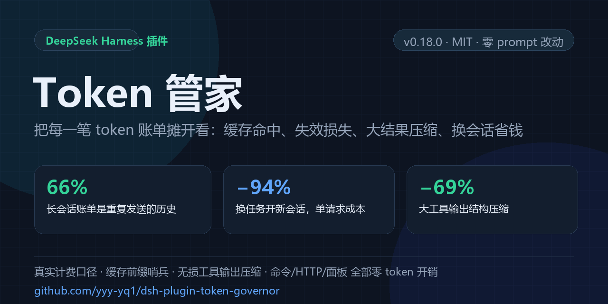

# Token 管家 · dsh-plugin-token-governor

[](LICENSE)
[](https://nodejs.org)
[](https://github.com/yyy-yq1/dsh-plugin-token-governor)
[](https://github.com/yyy-yq1/dsh-plugin-token-governor)



> **给 DeepSeek Harness 装一只"费率表 + 缓存哨兵 + 输出压缩器"：每一分钱花在哪、下一次哪笔会白烧、哪些 token 本可以不发，全部变成看得见的数字。**

DeepSeek Harness (DSH) plugin that turns your token bill into observable, actionable numbers:
real billed cost (cache-hit / miss / output, peak and off-peak), prompt-cache prefix sentinels,
cache-safe reasoning-effort scheduling, and lossless tool-output compression.

---

## 你的钱花在哪（一笔真实账单）

| 事实 | 数字 |
|---|---|
| 一个长会话的账单，**重复发送的历史**占了多少 | **≈66%** |
| 1 个输出 token 的价格 = 多少个**缓存命中**输入 token | **90 ~ 200 个** |
| 每请求固定前缀（工具 schema + 系统提示） | **≈16k tokens**（其中工具 schema 11.6k） |
| 一次缓存被打成全 miss 的代价 | **¥0.3 ~ 0.6** |
| 长会话里"再问一句"的单请求成本 | **¥0.008 ~ 0.012** |
| 命中率的自然上限（新增内容必然 miss） | **≈99%** |

也就是说：**省 DeepSeek 的钱，不是"删历史"，而是「别让缓存失效」+「别把大结果原样塞进上下文」+「任务换了就换会话」。**
本插件就做这三件事，外加把它们全部量化给你看。

## 它做什么

| 能力 | 一句话 | 改模型输入？ |
|---|---|---|
| **真实计费核算** | 读 provider 的真实 usage（命中/未命中/输出，含思考），按官方价目表（峰谷、CNY/USD）算 ¥ | 不改 |
| **缓存前缀哨兵** | 命中率骤降时立刻告警：多付了多少 token、多少钱、归因到最近哪次事件（换 effort / 压缩 / 工具变动 / 空闲过期 / 服务端驱逐） | 不改 |
| **切换守卫 + 自动回滚** | 自动降 effort 后若紧跟一次缓存崩塌，自动切回原档并暂停降档 | 不改 |
| **无损 TSV 重编码** | 均匀 JSON → 表格，**可逆**、零损失，同数据省 32%~59% token | 只在结果进入上下文时 |
| **结构感知压缩** | 超大工具输出按目标比例保留（大结果 −51%~−69%），全文落盘、`read` 可回取 | 只在结果进入上下文时 |
| **近重复 stub** | 与上文 99% 相同的输出压成"只列变更行 + 原文路径" | 同上 |
| **读取复用** | 同文件同区间内容未变，第二次 `read` 直接引用上文，不再重复占位 | 同上 |
| **交接新会话** | `/token new` 生成交接单并开新会话：42 万上下文 **¥0.0084/请求 → ¥0.0005（−94%）** | 新会话天然安全 |
| **压缩 A/B** | 端到端对比"压缩开/关"的每请求真实成本，不看压缩率看账单 | 不改 |
| **归因与决策** | 子会话成本、上下文增长归因、继续/压缩/新会话三种选择的每请求成本与回本轮数 | 不改 |
| **持久账本** | 跨会话、跨重启累计总消耗/命中/未命中/输出/API 请求次数，分会话明细 | 不改 |

**它不是又一层面板。** 所有统计走命令 / HTTP / 客户端轮询，**一个模型 token 都不花**；面板改动不触碰 prompt。

## 三条设计红线（这是它敢叫"省钱"的底气）

1. **绝不改写历史。** 任何压缩只发生在"结果进入上下文的瞬间"（append-only），已缓存的前缀一个字节都不动。
   —— 市面上一堆"省 token"方案靠摘要/裁剪历史，**一次改写就触发整段 miss，省 10% 花 200%**。
2. **绝不改工具 schema。** 插件在有活动会话时延迟注册自己的 `token_report` 工具（实测：中途加一个工具 = 30.8 万 miss ≈ ¥0.3~0.6）。
3. **官方机制优先。** ≥12,500 tokens 的超大结果交给官方 `spill-policy`，本插件让路；只处理它不管的那一档。压缩做的不是"删"，是"可逆编码 + 落盘 locator"。

## 实测能省多少（同一任务，开 vs 不开）

| 手段 | 实测 | 适用 | 代价 |
|---|---|---|---|
| 交接新会话 `/token new` | **−94%/请求**（¥0.0084 → ¥0.0005） | 上下文很大且要开新任务 | 冷启动一次性成本 |
| 防缓存失效 | **¥0.3~0.6 / 次**，自动回滚 | 装/升级插件、切 effort、改工具 | 无 |
| 结构压缩大结果 | **−51% ~ −69%** | 300 行以上输出、日志、表格 | 全文落盘（可回取） |
| 无损 TSV 重编码 | **−32% ~ −59%** | 均匀 JSON/表格结果 | 无损失 |
| 近重复 stub | **−99%**（7.3KB → stub） | 重复跑同命令/同测试 | 只保留变更行 |
| 排到空闲时段 | **−50%** | 所有重活 | 无 |
| 思考强度降档 | **默认关闭**（实测 max→high 在 flash 上 ≈0% 输出差异） | 你自己 A/B 过再开 | 思考变少 |

> 反直觉结论我们照实写：**文言文压缩 token 反而更贵**（+9.8%）、**默认 effort 降档基本不省**、**命中率不可能超过 ~99%**。
> 数据见下方「三个反直觉实测」。

## 30 秒安装

```bash
git clone https://github.com/yyy-yq1/dsh-plugin-token-governor.git
```

装（**不要手写 profile 的 `package.json` / `cordis.patch.yml`**），任选一种：

```bash
# ① 官方 CLI，直接从 Git 安装
dsh plugin --profile web add 'git+https://github.com/yyy-yq1/dsh-plugin-token-governor.git'

# ② 插件管理器（本机已 clone）
plugin_manager action=install_bundle target="<你克隆的路径>/dsh-plugin-token-governor"
```

装完即可用，无需配置：
- `/token` — 看本会话真实账单
- 设置 →「缓存与成本」面板（不产生模型请求；没显示就 F5）

> 和「用量看板」类插件的区别：它们回答"花了多少"，本插件回答**"为什么这么贵、下一次哪笔会白烧、怎么让同样任务更便宜"**。
> 计费、缓存失效、工具输出压缩、换会话，四件事是同一个成本问题的四个面。

## 日常用法

```
/token              # 本会话：请求数、命中率、三线费用、每请求 ¥、缓存异常、决策建议
/token doctor       # 自检：钩子/服务/账本/价格表是否真的在采数据（排障先跑这个）
/token trim         # 计算"从未调用的工具"，对之后的新会话裁剪 schema 固定税
/token out on|off   # 短输出续步降 effort（默认开，轮末/出错自动恢复）
/token limit on|off # 源头限流开关（默认关，实验；仅本次运行生效）
/token all          # 进程启动以来
/token prices       # 官方价目表 + 当前高峰/空闲
/token new          # 交接单 + 开新会话（大上下文换任务的省钱主力）
/token handoff      # 只生成交接单
/token ab on|off    # 压缩 A/B 分段
/token auto on|off  # effort 调度开关（默认关）
```

> **`/token doctor` 是信任前提**：DSH 升级后钩子可能静默失效，表现是"这个会话好便宜"。
> 自检会逐项列出 `llm/stream` 是否收到过数据、工具钩子是否触发、账本是否可写、价格表是否过期——
> 有任何 ❌ 就先别信账单数字。

`/token` 输出示意（数据来自一次真实会话）：

```
Token 管家 · 本会话
请求 91 · 缓存命中 29.28M / 未命中 42,157 · 输出 65,434（含思考）
费用 ¥0.8896 · 每请求 ¥0.00978 · 命中输入占总费用 66%
上下文体积：平均 38.4 万 tokens · 仅上下文 ≈¥0.0077/请求
缓存：单元利用率 99.3% · 失效损失 12.6 万 tokens ≈¥0.02（压缩后 1 次 / 空闲 1 次）
压缩：结构 12 次（−61%）· TSV 4 次（−44%）· 近重复 3 次（−99%）· 读取复用 5 次
决策：本任务还需 >29 轮才值得 /compact；**换任务建议 /token new（约 ¥0.0005/请求）**
```

HTTP（自建看板 / 接 Grafana）：

```bash
GET  /token-governor/api/report           # 结构化 JSON: 总消耗/命中/未命中/输出/请求数/分会话
GET  /token-governor/api/doctor           # 自检结果 JSON（ok + checks[]）
GET  /token-governor/api/text?session=<id>
GET  /token-governor/api/handoff
POST /token-governor/api/new-session?confirm=true
```

## 面板

设置 →「缓存与成本」：KPI（每请求 ¥、命中占比）、总消耗 Tokens（跨会话跨重启累计）、分会话明细、未命中来源、决策与验证卡片、上下文增长，以及 **20 个运行时开关**。

**开关面板**：每个开关一行，行内直接写明「开：…」「关：…」，并标注生效范围：

| 范围 | 含义 |
|---|---|
| 立即生效 | 下一个请求就按新值执行 |
| 仅新会话生效 | 只影响之后创建的会话；当前会话的缓存前缀不会被破坏 |
| 重启生效 | 需要重启 DSH 才会重新注册（HTTP API） |

覆盖的开关：短步骤降思考、源头限流、工具输出压缩、无损 TSV、重复去重、近重复压缩、读取复用、思考强度调度、缓存失效告警、换会话建议、压缩前交接提示、上下文增长归因、工具固定税裁剪、一键换会话、简洁输出风格、输出风格 A/B、子会话降档路由、预算保护、持久账本、HTTP API。

> 这些是**运行时开关**（重启回到 profile `cordis.patch.yml` 里的值）；要长期生效请改该文件，面板只负责即开即用和解释。

```
┌ 缓存与成本 ────────────────────────────────┐
│ 每请求 ¥0.0098   命中输入占成本 66%         │
│ 总消耗 29.39M tok   命中 29.28M  未命中 42k │
│ 决策：换任务 → /token new（−94%/请求）      │
└────────────────────────────────────────────┘
```

## v0.20：五项再省（按真实账单缺口排序）

| # | 动作 | 默认 | 说明 |
|---|---|---|---|
| ① | **一键换会话** | 面板按钮 | 「换新会话（省 ¥）」直接建会话并投递交接单，把平均 165k 上下文换成 ~25k |
| ② | **压缩覆盖扩展** | 开 | 新增 glob/ls/find/tree 路径清单的步进采样；aggressive 阈值 4000→**2500**、目标 0.35→**0.3** |
| ③ | **短输出续步降 effort** | 开 | 上一步输出 <250 tokens（典型"只调个工具"）→ 后续步骤降为 `low`；出错升级、轮末恢复；`/token` 显示降档 vs 其他平均输出 |
| ④ | **工具固定税裁剪** | 手动 | `/token trim` 找出"声明了但从没调用"的工具，对**新会话**禁用（不动运行中会话的工具声明，避免缓存失效） |
| ⑤ | **源头限流**（实验） | **关** | 对 `cat/ls/git/grep…` 这类只读的**单条简单命令**（不含管道/重定向/`&&`/`;`/反引号）追加输出上限：bash→`\| head -n 400`，pwsh→`\| Select-Object -First 400`；会改变退出码语义，且截断内容不可回取 |

**⑤ 的开关在哪**（它没有 GUI 开关，只有命令 + 配置两处）：

```bash
/token limit on     # 立即生效（仅本次运行），/token doctor 可看 sourceRewrites 计数
/token limit off    # 关掉
```

持久化：在 **profile 的 `cordis.patch.yml`**（不是插件包里的那个）追加一行覆盖：

```yaml
- id: token-governor
  config:
    sourceLimits:
      enabled: true
```


> ②③ 都不改写历史：压缩发生在结果进入上下文时，effort 不进 prompt，缓存命中不受影响。
> ③ 的收益需要你观察 `/token` 里"输出治理"那行的两组平均输出；若降档后没变小，就 `/token out off`。

## 自检与自维护（v0.19）

- **`/token doctor`**：逐项检查——`llm/stream` 是否收到过数据、工具钩子是否触发、`tools/commands/webServer/llm/agents` 服务是否可用、
  账本目录是否可写、账本是否轮转、价格表是否过期、官方 `spill-policy` 是否被识别、HTTP API 是否开到公网。
  任何 ❌ 都意味着"数字可能是假的"，先修再信。
- **账本自动轮转**：JSONL 超过 `ledger.maxBytes`（默认 5 MB）就滚成 `.1`、`.2`…，只保留 `ledger.keepFiles`（默认 3）份，
  启动时也会检查一次。长期挂机不会把账本养成几十 MB。

```yaml
- id: token-governor
  config:
    ledger:
      enabled: true
      path: ''                # 空 = ~/.dsh/token-governor/ledger.jsonl
      maxBytes: 5242880       # 5 MB 轮转
      keepFiles: 3            # 保留 ledger.jsonl.1 ~ .3
```

## 三个反直觉实测（用真实 tokenizer / 真实账单，不是估算）

1. **文言文≠更省。** 同一段含义：现代中文 123 tok → 文言文 **135 tok（+9.8%，更贵）**；电报体 117（−5%）。
   分词器按现代高频串合并 token，文言组合反而更碎。→ 方向对，载体错。
2. **effort 降档默认不省。** 同会话配对：max 续步平均 1,017 tok（n=117）vs high 1,011 tok（n=19），**−0.5%（噪声内）**。
   跨会话看到的 −20% 是选择偏差。→ 所以策略默认关闭，只在你自己的 A/B 里打开。
3. **命中率天花板 ≈99%。** 72 会话 9,839 请求里，未命中 59.9% 是"每步新内容"（不可避免），20% 是服务端驱逐，
   12.9% 是压缩后重写，6.4% 冷启动。→ 能改善的只有"一次性灾难失效"，那正是本插件盯的部分。

## 配置速查

只改你需要的；其余留默认。完整注释见 [`cordis.patch.yml`](cordis.patch.yml)。

```yaml
- id: token-governor
  config:
    currency: CNY                      # CNY | USD（官方两套价，不是汇率）
    modelPrices: {}                    # 自定义模型价：{ "<model>": { hit, miss, out } }
    effortPolicy:
      enabled: false                   # 实测≈不省，A/B 过再开
      continuationEffort: high
      switchGuard: { autoRollback: true, maxContextTokens: 250000 }
    contextAdvice: { minContextTokens: 150000 }     # 超过就建议换新会话
    toolOutput: { compressEnabled: true, nearDedupeEnabled: true, dedupeEnabled: true }
    tsvCodec: { enabled: true, minSavingRatio: 0.3 } # 无损重编码
    readReuse: { enabled: true }
    compressionBudget: { aggressiveAboveTokens: 4000, aggressiveTargetRatio: 0.35 }
    newSession: { enabled: true, model: deepseek-flash }
    apiPath: /token-governor
    priceStaleDays: 90                # 价格表过期告警
```

## 适合谁 / 不适合谁

- ✅ 天天用 DSH 跑长会话、想知道"到底花了多少 / 为什么这么贵"的人
- ✅ 需要给团队/客户看成本、需要可导出数字的人
- ✅ 工具输出又多又大的（读日志、跑测试、抓网页、导数据）
- ❌ 想要"自动帮你删历史、自动摘要"的：本插件刻意不做（会打爆缓存）
- ❌ 期待"开箱立省 50%"的：省钱动作是有代价的选择，插件负责把证据摆在你面前

## 已知限制

- 统计从**插件加载时刻**开始；加载前的历史不在本会话总计里。
- 思考 token 与普通输出在 DeepSeek Anthropic 接口上不可拆分，`outputTokens` 含思考。
- 峰谷按请求开始时刻判定，跨边界请求可能有半价差。
- 价格表基准日 2026-11-11，调价后请覆盖 `modelPrices`（超过 90 天会告警）。
- 统计口径是"插件看到的请求"，与官方账单可能有极小偏差，以官方为准。

## 版本记录

<details>
<summary>v0.21.0 — 所有开关进 GUI</summary>

面板新增开关总表（20 项，每项写明开启/关闭的效果与生效范围）；宿主新增 `POST /api/switch`（白名单）与 `snapshot.switches`。单测 28 项。
</details>

<details>
<summary>v0.20.2 — 源头限流开关</summary>

新增 `/token limit on|off` 运行时开关；文档补充持久化位置（profile 的 `cordis.patch.yml`）。
</details>

<details>
<summary>v0.20.1 — 源头限流补强</summary>

⑤ 收紧触发条件（单条简单命令：排除管道/重定向/`&&`/`;`/换行/反引号/`$()`）、支持 pwsh（`Select-Object -First N`）、新增 `diagnostics.sourceRewrites` 计数并接进 `/token doctor`。
</details>

<details>
<summary>v0.20.0 — 五项再省</summary>

① 面板一键换会话；② 压缩覆盖 glob/ls 清单、aggressive 阈值 4000→2500 / 目标 0.3；③ 短输出续步降 effort（默认开，含降档/非降档平均输出对照）；④ `/token trim` 工具固定税裁剪（仅新会话）；⑤ 实验性源头限流（默认关）。单测 25 项。
</details>

<details>
<summary>v0.19.0 — 自检与账本轮转</summary>

新增 `/token doctor`（及 `GET /api/doctor`）：检查 llm 钩子是否在采数据、工具钩子是否触发、宿主服务是否可用、账本是否可写、价格表是否过期、官方 spill 是否识别。
账本按 `ledger.maxBytes`（默认 5 MB）轮转、保留 `ledger.keepFiles`（默认 3）份；启动时也检查一次。单测 25 项。
</details>

<details>
<summary>v0.18.1 — 上架物料（仅文档）</summary>

新增 `docs/social-preview.png`（社交预览图）与 `docs/store-listing.md`（市场字段填写资料）；README 增加一行安装方式与"与用量看板的区别"。
</details>

<details>
<summary>v0.18 — 上下文体积六项优化</summary>

1. `/token new` 交接新会话：42 万上下文 ¥0.0084 → ¥0.0005/请求
2. 无损编码扩展：嵌套 JSON 扁平化点号字段、JSONL 按行解析
3. 读取复用：同文件同区间内容未变时引用上文
4. 压缩预算：>4000 tokens 的大结果按 ≤35% 目标压缩（300 行 22,127B→6,790B）
5. 上下文增长归因：prompt 增量按来源拆分
6. compaction 后端 spike：保持官方 backend
</details>

<details>
<summary>v0.15 — 六项开源灵感优化</summary>

近重复压缩（归一化去时间戳/UUID/hex 后相似度 ≥0.9 → stub）、按工具保留策略（read 保 landmark 压到 40%、grep 每前缀 1 行、日志错误行 ±1）、
prompt 风格实验、子会话模型路由、分支/前缀审计、compaction digest（提示交接代替 /compact）。
</details>

<details>
<summary>v0.14 — 验收缺陷全量修复</summary>

分词器校准估算（CJK≈0.20 tok/char）、terse-verify 限流、压缩 A/B 质量指标、真实模型窗口、官方 spill 预算自动读取、effort 切换归因、错误行上下文、spill 清理（72h/40 个）、价格过期告警。
</details>

<details>
<summary>v0.13 — 压缩 A/B、子会话归因、决策规划器、交接单</summary>

端到端压缩 A/B、子会话成本归因与 fork/fresh 建议、三选一决策规划器、可粘贴交接单、snapshot 原子写。
</details>

<details>
<summary>v0.12.3 — 与官方原生机制分工（不冲突）</summary>

≥12,500 tokens 交给官方 `spill-policy`；保留 `additionalContexts`；两条链路各写各的 locator，绝不对同一结果二次改写。
</details>

<details>
<summary>v0.10 — 无损 TSV 重编码</summary>

均匀数组行 → TSV，可逆；30 行 JSON 实测 1,705 → 694 字符（−59%）。字符节省 <30% 不采纳。
</details>

<details>
<summary>v0.9 — 文言文方向：实测后否定</summary>

现代文 123 tok / 文言文 135 / 电报 117 / 英文 255。落地：`/api/tokenize` 真实分词探针 + `terseStyle`（默认关）。
</details>

<details>
<summary>v0.8 — 切换缓存防护 + 上下文体积治理</summary>

降档后监控下一次主请求命中，崩塌则自动回滚并暂停；上下文超过阈值提示换新会话。
</details>

<details>
<summary>v0.5–v0.7 — 缓存单元量化、省钱开关</summary>

追加式理想利用率、失效损失（72 会话 7,314,068 tokens ≈¥7.2~14.3）、首请求公共前缀复用、工具 schema 固定税（26 个未用工具 ≈5,955 tok/请求）、预算保护、错峰提示、工具裁剪。
</details>

<details>
<summary>v0.1–v0.4 — 计量、缓存哨兵、GUI</summary>

真实 usage 计费、缓存异常归因、effort 调度（不改前缀）、面板与实时条、缓存安全安装（有活动会话时延迟注册工具）。
</details>

## 参与

- 发现价格错误 / 计费口径偏差：开 issue，附官方价目页与模型名。
- 想加新的压缩编码：`governance.js` 是纯函数层（无 DSH 依赖），`npm test` 直接测。
- 测试：`npm test`（25 项全绿）。

## License

MIT © 2026 yyy-yq1 — 见 [LICENSE](LICENSE)。
